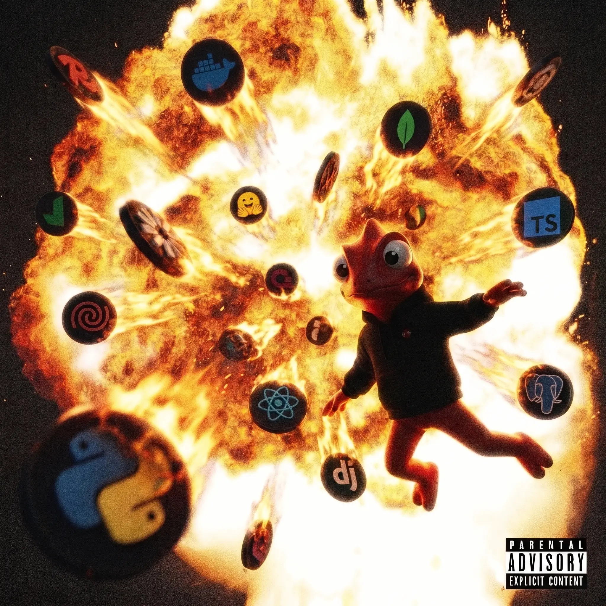

<h1 align="center">Ikram Mbechezi</h1>

  <b>Software Engineer, Full Stack TypeScript</b> 
  Greater Paris Area · Hybrid / Remote · <i>Open to opportunities (EN/FR)</i>

  
  
  
  

## Hey! I'm Ikram.
For over 3 years, I have been designing and building end-to-end digital products. 
**Architecting and developing** full-stack web applications 
**Automating** business workflows and data pipelines such as ingestion and payments. 
**Designing** AI tools, SaaS solutions, and interconnected systems

## My Everyday Tools

<h3>Languages</h3>

  
  
  
  

<h3>Web</h3>

  
  
  
  
  

<h3>Data</h3>

  
  
  

<h3>Ship & Run</h3>

  
  
  
  
  

## Selected projects

<table>
  <tr>
    <td align="left" valign="top" width="50%">
      
       
      <a href="https://mescertifs.fr/"><b>MesCertifs.fr</b></a>
       
      A search engine for state-recognized professional certifications in France (RNCP, RS), powered by public data from France Compétences.
       
      <a href="https://mescertifs.fr/">Visit website</a>
    </td>
    <td align="left" valign="top" width="50%">
      
       
      <a href="https://mo.mbechezi.fr/"><b>Making Of - Mescertifs</b></a>
       
      How a certification search platform was built, as an interactive timeline. 56 technologies over 2–3 years.
       
      <a href="https://mo.mbechezi.fr/">Discover</a>
    </td>
  </tr>
</table>
